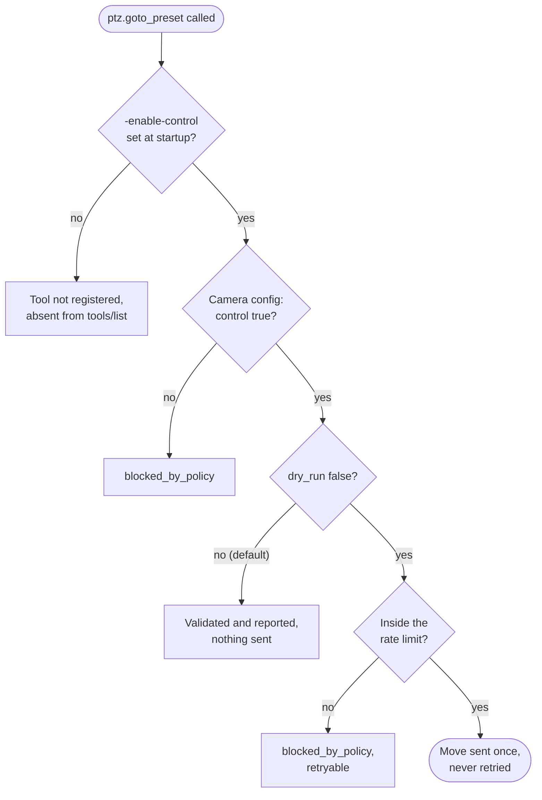

<p align="center">
  <picture>
    <source media="(prefers-color-scheme: dark)" srcset="assets/logo-dark.svg">
    
  </picture>
</p>

<p align="center">
  Typed, safe ONVIF camera control for LLM agents, as a Model Context Protocol server written in Go.
</p>

<p align="center">
  <a href="https://github.com/0x524a/onvif-mcp/actions/workflows/ci.yml"></a>
  <a href="LICENSE"></a>
  <a href="go.mod"></a>
</p>

An agent that can move a camera can also point it at the wrong place, forever, in a loop. onvif-mcp
gives an agent thirteen tools over stdio: ten read the camera, and three act on it
behind separate gates. Credentials never appear in a tool argument, every string that leaves the
server is scrubbed, and a camera that misbehaves produces an error the agent can act on
instead of raw SOAP.

## Status

v0.2.x adds two gated PTZ tools and a read-only HTTP transport to the eleven tools of v0.1.0. The
read tools have been run against five physical cameras (Axis, Reolink, Bosch), and `ptz.move_relative`
with `ptz.stop` against one Reolink TrackMix. Everything else, `ptz.goto_preset` included, has only
been exercised against onvif-go's virtual camera and hand-written SOAP fixtures, so other cameras'
quirks may not be handled yet. The server is read-only unless the operator starts it with
`-enable-control` **and** a camera opts in with `"control": true`.

New in v0.2: two more gated tools, `ptz.move_relative` and `ptz.stop`, and a
**read-only streamable HTTP transport** (`-transport http`, see
[Serving over HTTP](#serving-over-http)). Write tools are not offered over HTTP at all.

## Quick start

No camera needed. This starts a virtual ONVIF camera and the server together, and you
talk to the server by pasting JSON-RPC lines:

```bash
git clone https://github.com/0x524a/onvif-mcp && cd onvif-mcp
make demo
```

The walkthrough [further down](#try-it-without-a-camera) lists the cameras, finds a preset, shows
the dry run, then moves the virtual camera. To use your own cameras:

```bash
go install github.com/0x524a/onvif-mcp/cmd/onvif-mcp@latest
cp testdata/cameras.example.json cameras.json && chmod 600 cameras.json   # edit endpoints and usernames
onvif-mcp -config cameras.json
```

Then point your MCP client at the `onvif-mcp` command with `-config cameras.json` as its arguments.
Go 1.25 or newer is required to build.

## Tools

| Tool | Purpose | Kind |
|------|---------|------|
| `camera.list` | List configured cameras; optionally probe reachability | read-only |
| `camera.discover` | WS-Discovery probe that returns candidates to add to the config | read-only |
| `camera.describe` | Device information and advertised services | read-only |
| `media.profiles` | Media profiles and whether each has PTZ | read-only |
| `media.stream_uri` | Stream URI for a profile, credentials removed | read-only |
| `stream.inspect` | Open a profile's RTSP stream and report codecs, tracks and best-effort resolution | read-only, open-world |
| `camera.snapshot` | Capture one still image from a profile and return it inline | read-only, open-world |
| `imaging.settings` | Current imaging settings of a video source | read-only |
| `ptz.status` | Current PTZ position and movement state | read-only |
| `ptz.presets` | Stored presets and reported movement limits | read-only |
| `ptz.goto_preset` | Move a camera to a stored preset | write, gated (see below) |
| `ptz.move_relative` | Nudge a camera by a small relative amount (at most 0.25 per axis per call) | write, gated (see below) |
| `ptz.stop` | Stop pan, tilt and zoom on a profile, then report whether the camera confirms it | halt, gated (see below) |

## How a move is gated



Each gate is checked by the server, not requested from the model. Every attempt, allowed or
refused, is written to stderr as an audit line without arguments or credentials. The diagram
is the path of a write tool; `ptz.stop` is the exception and skips the dry run and the rate
limit (see [ptz.move_relative and ptz.stop](#ptzmove_relative-and-ptzstop)). The details,
including what happens when a send fails halfway, are under [ptz.goto_preset](#ptzgoto_preset).

## Try it without a camera

`make demo` needs no hardware. It builds and starts `cmd/demo-camera`, a virtual ONVIF camera
(onvif-go's `server` package) listening on `127.0.0.1:18080`, then runs onvif-mcp on your
terminal's stdio against [testdata/demo.json](testdata/demo.json). The camera is a separate
process because nothing but JSON-RPC may reach the server's stdout. The demo credentials in
that file belong to a simulator reachable only from your own machine; they are not secrets and
must not be reused. Git does not keep file modes, so `make demo` copies the config to a
private temporary file with mode 600 first. Stdin ending (ctrl-d) stops both processes.

**Control is off unless `-enable-control` is passed and the camera sets `"control": true`.**
With control off, `ptz.goto_preset`, `ptz.move_relative` and `ptz.stop` do not appear in `tools/list` at all. The demo turns
both on (the flag in the Makefile, `"control": true` in `demo.json`) so you can see a move.
To see the read-only server instead (ten tools), start `go run ./cmd/demo-camera` in one
terminal and run onvif-mcp without `-enable-control` against a mode-600 copy of `demo.json`.

Run `make demo`, then paste these lines one at a time into the terminal, waiting for each
reply (calls sent together run concurrently and may finish out of order, and ending stdin
abandons any call still running). The tokens below are the virtual camera's fixed ones.

```json
{"jsonrpc":"2.0","id":1,"method":"initialize","params":{"protocolVersion":"2025-06-18","capabilities":{},"clientInfo":{"name":"demo","version":"0"}}}
{"jsonrpc":"2.0","method":"notifications/initialized"}
```

1. `camera.list` gives the camera id:

   ```json
   {"jsonrpc":"2.0","id":2,"method":"tools/call","params":{"name":"camera.list","arguments":{}}}
   ```
   ```text
   data.cameras = [{"control_allowed":true,"endpoint":"http://127.0.0.1:18080/onvif/device_service","id":"vcam"}]
   ```
   (`control_allowed` is the camera's own opt-in; the server-wide flag is reported by the
   `onvif://server/policy` resource.)

2. `media.profiles` gives a profile token; `profile_0` and `profile_2` have PTZ:

   ```json
   {"jsonrpc":"2.0","id":3,"method":"tools/call","params":{"name":"media.profiles","arguments":{"camera":"vcam"}}}
   ```
   ```text
   3 profile(s): profile_0 (H264 1920x1080, PTZ, source=video_source_0); profile_1 (H264 1280x720, source=video_source_1); profile_2 (H264 1920x1080, PTZ, source=video_source_2).
   ```

3. `ptz.presets` gives a preset token:

   ```json
   {"jsonrpc":"2.0","id":4,"method":"tools/call","params":{"name":"ptz.presets","arguments":{"camera":"vcam","profile":"profile_0"}}}
   ```
   ```text
   data.presets = [{"name":"Home","pan":0,"tilt":0,"token":"preset_0","zoom":0},
                   {"name":"Entrance","pan":-45,"tilt":-10,"token":"preset_1","zoom":0.5}]
   ```

4. `ptz.goto_preset` with no `dry_run` field is a dry run. It validates and reports the
   target; nothing is sent to the camera:

   ```json
   {"jsonrpc":"2.0","id":5,"method":"tools/call","params":{"name":"ptz.goto_preset","arguments":{"camera":"vcam","profile":"profile_0","preset":"preset_1"}}}
   ```
   ```text
   data = {"dry_run":true,"executed":false,"preset":"preset_1","preset_name":"Entrance","profile":"profile_0",
           "target_pan":-45,"target_tilt":-10,"target_zoom":0.5,
           "note":"Dry run: nothing was sent and the camera did not move. To move it, call ptz.goto_preset again with the same arguments and dry_run false. Movement limits not reported."}
   ```

5. The same call with `"dry_run":false` moves the camera:

   ```json
   {"jsonrpc":"2.0","id":6,"method":"tools/call","params":{"name":"ptz.goto_preset","arguments":{"camera":"vcam","profile":"profile_0","preset":"preset_1","dry_run":false}}}
   ```
   ```text
   data = {"dry_run":false,"executed":true,"preset":"preset_1","preset_name":"Entrance","profile":"profile_0",
           "target_pan":-45,"target_tilt":-10,"target_zoom":0.5,
           "note":"The camera returned HTTP success for the move command; that does not confirm it accepted it, and it may still be moving. Call ptz.status to confirm where it is."}
   ```

6. `ptz.status` confirms where the camera is (a moment later it reports `IDLE`; immediately
   after the move it can still report `MOVING`):

   ```json
   {"jsonrpc":"2.0","id":7,"method":"tools/call","params":{"name":"ptz.status","arguments":{"camera":"vcam","profile":"profile_0"}}}
   ```
   ```text
   data = {"pan":-45,"tilt":-10,"zoom":0.5,"pan_tilt_state":"IDLE","zoom_state":"IDLE"}
   ```

Each real and dry attempt is also written to the server's stderr as an audit line. Run
`make demo` again to start the camera back at pan 0, tilt 0.

## Serving over HTTP

`onvif-mcp` speaks stdio by default. `-transport http` serves the **read** tools over
streamable HTTP instead, so a containerised or remote agent can use them. It is
stateless (no `Mcp-Session-Id`), answers every request with a single JSON body, and
speaks HTTP/1.1 only. **No state-changing tool is registered on this transport**:
`ptz.goto_preset`, `ptz.move_relative` and `ptz.stop` do not exist over HTTP, and
`-transport http -enable-control` is a usage error (exit 2). Motion stays on stdio.

### Quick start (loopback)

```bash
make demo-http          # virtual camera + server on 127.0.0.1:8808, read-only
```

It makes a throwaway token, starts the server, and prints a `curl` line to call
`camera.list` with it (the token is shown once and is for the demo only). By hand:

```bash
onvif-mcp -new-token laptop-agent          # line 1: the token (keep it); line 2: its token-file entry
printf '{"tokens":[%s]}\n' '<line 2>' > tokens.json && chmod 600 tokens.json
onvif-mcp -config cameras.json -transport http -http-tokens tokens.json   # 127.0.0.1:8808
```

`openssl rand -hex 32` makes an equivalent token, but `-new-token` also prints the entry
that goes in the file. The file holds only SHA-256 digests; the token is never stored.
A client sends `Authorization: Bearer <token>` with each `POST /mcp` (and
`Accept: application/json, text/event-stream`). Whether a given MCP client lets you set
that header is up to the client; the Go SDK client does.

Send one JSON-RPC message per `POST`; a batch array is refused with 400.

### Flags

| Flag | Meaning |
|------|---------|
| `-transport stdio\|http` | Default `stdio`. |
| `-listen ADDR` | HTTP only. Default `127.0.0.1:8808`. An IP literal or `localhost`; other names are refused (a name is never resolved to decide a security property). |
| `-http-tokens PATH` | Token file, mode 600. **Required** with `-transport http`; there is no unauthenticated mode, loopback included. |
| `-http-allow-remote` | Permit a non-loopback `-listen`. Needs all of: TLS, a token file, `-http-allowed-hosts`. |
| `-http-allowed-hosts a,b` | `Host` names accepted besides `localhost`, `127.0.0.1`, `::1` (the loopback defaults apply on a loopback bind only). Exact match, no wildcards. |
| `-tls-cert PATH`, `-tls-key PATH` | Serve TLS in-process (TLS 1.2 or newer; key file mode 600). Both or neither. Loaded once at start; no reload. |
| `-new-token ID` | Print a fresh token and its token-file entry, then exit. Only combinable with `-version`. |

Flag errors are exit 2 and are found before any file is opened or socket bound.
`-snapshot-max-bytes` above its default is refused with `-transport http` (replies are
buffered in memory).

### Token file

```json
{"tokens": [
  {"id": "laptop-agent", "sha256": "<64 lowercase hex>"},
  {"id": "ops-agent", "sha256": "<64 lowercase hex>", "grant": ["camera.snapshot", "stream.inspect"], "expires": "2027-01-31T00:00:00Z"}
]}
```

Every token reads `camera.list`, `camera.describe`, `media.profiles`, `media.stream_uri`,
`imaging.settings`, `ptz.status` and `ptz.presets`. Three tools reach further and are
**opt-in per token** through `grant`: `camera.snapshot` (live imagery), `camera.discover`
(multicast and probing from the server's LAN) and `stream.inspect` (server-originated RTSP
connections). A token without the grant neither sees nor can call them. Only exactly 64
lowercase hex characters (what `-new-token` prints) are accepted as a token. Unknown
fields, including `control`, are rejected. Rotation and revocation are an edit and a
restart; a call already running for a revoked token finishes (at most 120 s).

### TLS and reverse proxies

Plain HTTP is allowed on loopback only. For another machine use `-tls-cert`/`-tls-key`
with `-http-allow-remote` and `-http-allowed-hosts`, or bind loopback behind a proxy that
terminates TLS and pass the public name in `-http-allowed-hosts`. `X-Forwarded-*` is never
read; the audit log shows the proxy as the peer, and the token id is the identity.

### Limits and responses

These are constants, not flags (`internal/httpserver/options.go`, `internal/mcpserver/http.go`):

| Limit | Value |
|-------|-------|
| Connections, total | 128 |
| Connections per remote IP (IPv6 by /64) | 8, non-loopback peers only: a loopback bind, or a local proxy, is exempt, so put connection limits in the proxy |
| Read header / whole request / idle / write | 5 s / 30 s / 60 s (authenticated connections only) / 180 s |
| Header block / request body | 16 KiB / 64 KiB |
| JSON-RPC batch arrays | refused (400); one request, one reply |
| Requests in flight | 32 (then 503) |
| Tool calls in flight | 32 in total, 8 per token (then a `blocked_by_policy` tool error with `retry_after_seconds`) |
| One tool call | 120 s; a camera with a longer `timeout_seconds` is cut off earlier over HTTP |
| Shutdown | stop accepting, wait up to 10 s for calls in flight, then cancel them and allow 2 s to reply; a second signal ends the process at once |

Status codes: 401 for every authentication failure, with identical bytes; 403 for a `Host`
off the allowlist or any `Origin` header; 404 for any path but `/mcp`; 405 for GET, DELETE
and OPTIONS; 400, 413, 415 and 431 for malformed (including batch), oversized or mistyped requests; 503
while draining or when 32 requests are in flight. 429 is not used. Every response sent
before a request authenticates closes the connection.

Memory: a snapshot reply is buffered. The figures below come from a one-off local
measurement in-process with the SDK (Go 1.26.9); no test in this repository reproduces
them and they will vary with the SDK version and host. One 1 MiB image (1.3 MiB of JSON)
raised peak heap use by about 13 MiB, and one 8 MiB image (10.7 MiB of JSON) by about 83 MiB: roughly eight to ten times the reply. That is
why HTTP keeps the 1 MiB default snapshot cap, and an upper estimate with 32 snapshots
at once is around half a gigabyte. The estimate is arithmetic from the single-request
figures, not a measurement under load. On a small host, grant `camera.snapshot` to few
tokens.

## Reference

<details>
<summary><b>Configuration file and trust settings</b></summary>

Cameras are declared in a JSON config file addressed by operator-chosen IDs. Credentials
live in the config file or the environment, never in tool arguments. Each camera must opt
in to control (`"control": true`), and control tools stay disabled unless the server is
started with `-enable-control`.

Fields of each camera entry (the entry's key is the camera id an agent passes as `camera`):

| Field | Meaning |
|-------|---------|
| `endpoint` | The camera's ONVIF device service URL. Required. |
| `username`, `password` | Camera credentials. The password may instead come from the environment variable `ONVIF_MCP_<ID>_PASSWORD` (id upper-cased, `-` and `.` as `_`), which takes precedence over the file. |
| `timeout_seconds` | Per-request timeout in seconds, up to 300. Default 10. |
| `control` | Opt this camera in to write tools. Default `false`. Has no effect unless the server also runs with `-enable-control`. |
| `trust_advertised_hosts` | Allow service, stream and snapshot addresses on another host than `endpoint`. Default `false`; see below. |
| `allow_basic_over_http` | Allow `camera.snapshot` to answer a Basic-only challenge over plain `http`. Default `false`; see "Snapshots". |

A documentation-only example is in [testdata/cameras.example.json](testdata/cameras.example.json),
using the reserved address `192.0.2.10` and `REPLACE_ME` credentials. Copy it, edit it, and
restrict its permissions:

```bash
cp testdata/cameras.example.json cameras.json
chmod 600 cameras.json
```

The server refuses to start if the config file is readable by group or other, because it
holds credentials. Git does not preserve the owner-only mode, so a fresh clone or copy
needs the `chmod` above.

### Advertised service addresses and `trust_advertised_hosts`

A camera tells the server where its media, PTZ and imaging services live, and the server
sends authenticated requests there. A hostile or misconfigured camera could use that to
aim requests at an unrelated host. By default onvif-mcp therefore refuses any request whose
host differs from the host in the camera's configured `endpoint` (a different port on the
same host is fine, and loopback addresses are already rewritten to the configured host by
the client library). The tool then fails with `device_fault`: "camera advertised a service
address on another host".

For a camera behind NAT or with several addresses, set `"trust_advertised_hosts": true` on
that camera to turn the check off for it. The default is `false`. Hosts are compared as
written, so a camera configured by name that advertises its IP address needs the flag too.
The same flag decides whether `stream.inspect` may probe a stream, and `camera.snapshot` may
fetch an image, on another host; it never makes onvif-mcp send credentials there (see
"Stream credentials" and "Snapshots" below).

A reply body over 8 MiB is rejected with `device_fault` ("camera response too large")
instead of being read into memory.

</details>

<details>
<summary><b>Command line, exit codes and rate limits</b></summary>

```bash
onvif-mcp -config cameras.json
```

| Flag | Meaning |
|------|---------|
| `-config PATH` | Camera config file. Required. |
| `-enable-control` | Permit state-changing tools (each camera must also opt in). |
| `-snapshot-max-bytes N` | Largest image `camera.snapshot` returns, in raw bytes. Default 1048576 (1 MiB); allowed 1024 to 8388608. Not a config-file setting. |
| `-version` | Print the version to stdout and exit without starting the server. |

Write tools are rate limited per device: one movement per 2 seconds, burst 1. The budget is
keyed by the camera's endpoint (case, scheme, default port and a trailing slash are
ignored), so two config entries that point at the same endpoint share one budget. These
are code defaults (`safety.PolicyOptions`), and v0.1 has no flag or config key to change
them; `onvif://server/policy` reports the values in force.

The server speaks MCP over stdio: stdout carries only JSON-RPC, and all logging goes to
stderr. Exit codes: 0 on a clean shutdown (stdin closed, SIGINT or SIGTERM), 1 for a
configuration or runtime failure (including a config file with loose permissions), 2 for a
usage error such as an unknown flag or a missing `-config`.

</details>

### `ptz.goto_preset`

A tool that changes a camera (so are `ptz.move_relative` and `ptz.stop`, below). It takes `camera`, `profile` (a token from
`media.profiles` with `has_ptz` true), `preset` (a token from `ptz.presets`) and `dry_run`.
Three independent gates stand between an agent and a moving motor:

1. **The operator starts the server with `-enable-control`.** Without it the tool is not
   registered: it does not appear in `tools/list` and cannot be called. The
   `onvif://server/policy` resource still names it, says why it is gated and what an
   operator must do.
2. **The camera opts in** with `"control": true` in its config entry. A camera that has not
   opted in refuses with `blocked_by_policy`, for dry runs as well.
3. **The caller passes `dry_run: false`.** `dry_run` defaults to true. A dry run does the
   same validation a real call does (camera known, profile exists and carries PTZ, preset
   exists) and reports the preset's stored target position and the camera's reported
   movement limits, but never sends the move command. It says exactly what to send to
   move.

A real call is rate limited (see above), sends the move command once and never retries it.
A call that fails before anything is sent (a mistyped token, an unreachable camera, a
cancellation) gives its budget back and is audited as not executed. When the call
succeeds, the camera returned HTTP success; the library does not parse the reply, so that
does not prove the camera accepted the command, and it may still be moving. `ptz.status`
shows where it is. If a real call times out or faults after the command was
sent, the camera may or may not have moved: the error says so, is not marked retryable, and
the agent should check `ptz.status` before trying again. The same holds for any other
failure after the send, such as a reply that is not SOAP. Dry runs are not rate limited,
but each costs several round trips to the camera (connect, profiles, presets, limits), so
an agent looping on them still loads it. Validation as a whole is held to twice the
camera's `timeout_seconds`. Every attempt, dry or real, and
every refusal is written to stderr with the tool, camera, dry-run state, whether it executed,
the outcome and the preset token. Arguments and credentials are never logged.

`ptz.goto_preset` performs no clamping. The target is a preset the camera stored itself, so it
is reachable by construction; `reported_limits` is informational and is never compared with
the target. Absolute moves are not offered; if they are ever added, a camera that reports no
limits will fail closed rather than fall back to a guessed range.

### `ptz.move_relative` and `ptz.stop`

`ptz.move_relative` takes `camera`, `profile` (a token from `media.profiles` with `has_ptz`
true), `dry_run` and any of `pan`, `tilt`, `zoom`. It is gated exactly like `ptz.goto_preset`
(control flag, per-camera opt-in, `dry_run` true by default, the same per-device rate limit,
sent once and never retried).

- **Units.** The numbers are sent in the ONVIF generic translation space, with the space URI
  set explicitly on each vector; the dry run and the result show it (`space_sent`). What a
  value means physically, and which way a positive value moves the camera, is defined by the
  camera. After a small move check `ptz.status` or `camera.snapshot`. The server never
  converts between spaces.
- **Cap, refuse not clamp.** Each axis must be at most 0.25 in magnitude per call, at least
  one must be non-zero, and an omitted axis is 0. Anything else is refused with
  `invalid_argument` naming the field, the legal range, the source (the server's own cap) and
  a corrected call. Nothing is clamped silently, a refusal sends nothing, and it gives the
  rate token back.
- **No speed, no limits lookup.** The camera's default speed applies and may be its maximum.
  Relative moves do not consult the camera's reported limits; they are bounded by the cap, the
  rate limit and the dry-run default. The server cannot detect a camera that ignores the
  `Space` it was sent; the effect of one capped step on such a camera depends on the camera.
- **Finite.** The camera ends a relative move itself; nothing in this server has to stay alive
  for it to end.

`ptz.stop` takes `camera` and `profile` only. It has no `dry_run` and is **not** rate limited,
and a missing audit log cannot block it: the one call that must always get through. It still
requires the process to run with `-enable-control` and the camera to have opted in, because
the server can only have moved a camera that was granted. It runs detached from the request, so
a client cancel or a shutdown signal cannot abort a stop that was already dispatched. It sends
`Stop` for pan/tilt and zoom, with one immediate retry on a transport error, then reads the
status up to three times. `stop_status` is `confirmed_idle` (the camera reports idle),
`sent_unconfirmed` (delivered, but the camera said MOVING or UNKNOWN, reported no movement
state, or could not be read) or, as an error, a stop that was not delivered: call `ptz.stop`
again immediately. Stop is per profile: it addresses the profile you pass, so if you are unsure
which profile moved, call it once per `has_ptz` profile. A burst of stops is bounded per device
(at most two rounds in flight; a profile token that does not exist costs no `Stop`).

Honest limits of this version: a looping model can still issue up to 30 capped steps a minute
per device, and there is no cumulative travel budget; on an endless-rotation pan dome that can
turn the head continuously, and on any camera repeated steps wear the motors. This residual risk
is accepted because real calls default to dry runs, the rate limit holds a loop to 30 steps a
minute, and the audit trail makes a loop visible. Continuous and absolute moves are not offered.

A shutdown signal (SIGINT or SIGTERM) starts an orderly exit. A second signal within 5 seconds
is held, so it cannot abort a dispatched stop or a move in flight; a signal after those 5
seconds ends the process at once, aborting whatever is still running.

To enable it for one camera:

```bash
# in cameras.json, on the PTZ camera only:  "control": true
onvif-mcp -config cameras.json -enable-control
```

<details>
<summary><b>Output limits and caveats</b></summary>

- Every string in a tool result is stripped of control and formatting characters, scrubbed
  of registered secrets, and clipped to 256 characters. Non-finite numbers a camera reports
  are treated as not reported.
- Lists are capped, and a capped result says so with `truncated: true` and a `total`:
  `media.profiles` 100, `ptz.presets` 256, `camera.describe` services 64,
  `camera.discover` candidates 64. A repeated profile or preset token keeps its first
  entry and is counted in `duplicates_dropped`.
- `media.stream_uri` removes userinfo, known secret query keys, registered passwords and the
  fragment. A secret embedded in the URI path cannot be detected and is not removed. A URI
  over 2048 characters is a `device_fault`.
- `stream.inspect` runs the RTSP OPTIONS and DESCRIBE handshake against a profile's stream and
  reports `reachable`, `describe_ok`, `latency_ms` and up to 32 tracks (type, codec, and for
  H.264 and H.265 video the width and height). Resolution is parsed from the stream's own
  parameter sets and is best-effort; a track without it has no width or height. The result
  names the stream as scheme, host, port and path only. `timeout_seconds` defaults to 5 and is
  clamped to 10; it is independent of the camera's own `timeout_seconds` config setting. A
  stream that answers with an RTSP redirect is not followed (`device_fault`). Credentials never
  appear in its input or output (see below).
- `camera.snapshot` returns one JPEG or PNG as image content, with a one-line summary and
  `bytes`, `mime_type`, `width`, `height`, `profile` and `truncated` (always false) in the
  structured result. **The image enters the agent's context window**, so it is capped at
  1 MiB of raw bytes by default (`-snapshot-max-bytes`). A larger image is refused with its
  size, the limit and a hint to choose a lower-resolution profile from `media.profiles`; it is
  never cut. See "Snapshots" below.
- `camera.discover` blocks for its whole probe window (3 s by default, 10 s at most). The
  underlying library checks for cancellation only between packets, so a cancel or shutdown
  waits out the rest of the window. A host with no usable network interface fails with
  `unreachable`. Everything in a candidate is an unauthenticated claim by whatever answered;
  a device can also reuse a real camera's endpoint reference to overwrite its addresses, which
  is inherent to WS-Discovery. Candidates on a directly attached network are preferred when the
  list is capped.

</details>

<details>
<summary><b>Stream credentials</b></summary>

The stream address comes from the camera, so a hostile or compromised camera could name any
host. `stream.inspect` therefore adds the camera's configured username and password to the
RTSP URL itself, inside the server process, and only under these rules:

- The address's host must be the host of the camera's configured ONVIF endpoint (the rule
  that guards advertised service addresses). The scheme must be `rtsp` or `rtsps` and any
  port 1 to 65535. Userinfo the camera put in the address is discarded.
- Any other host is refused as `device_fault` ("camera advertised a stream address on another
  host") and **nothing is probed**: no credentials, and no connection either, so the tool
  cannot be used to scan an internal network.
- A camera whose config sets `trust_advertised_hosts` is the one exception: its other-host
  streams are probed, **without credentials** (`authenticated` is false). Unspecified,
  multicast, broadcast and link-local addresses (including 169.254.169.254) and numeric host
  spellings are refused even then, and the same check is applied to the address a
  host name resolves to, before any connection is made.
- The probe's client may open one connection, to the single address of the URL (resolved
  once), and never follows an RTSP redirect: a 3xx from the stream is an error, so a stream
  cannot steer the credentials, or the probe, to another host or port.
- The credentialed URL is never returned, logged or placed in an error. It lives in an
  unprintable registry type that only this tool can reach, and every output passes the
  redactor.

</details>

<details>
<summary><b>Snapshots</b></summary>

The snapshot address comes from the camera (ONVIF `GetSnapshotUri`), so it is treated as
hostile input. onvif-go's `DownloadFile` is not used for the fetch: it sends Basic credentials
to whatever URL it is given before any challenge, its Digest fallback follows redirects through
an unguarded client, and it reads the body without a limit. `camera.snapshot` fetches with its
own client inside the registry instead:

- The scheme must be `http` or `https`. A host other than the camera's configured one is
  refused as `device_fault` with **no request sent**; with `trust_advertised_hosts` it is
  fetched **without credentials** (so it must serve snapshots unauthenticated). Unspecified,
  multicast, broadcast and link-local addresses, numeric host spellings, and names that
  resolve to them are refused even then. That list includes the IPv4 address inside a NAT64,
  6to4 or IPv4-compatible IPv6 address, and the cloud metadata addresses `fd00:ec2::254`,
  `100.100.100.200` and `192.0.0.192`. A name with a trailing dot is not the camera's host.
- The host is resolved once and the connection goes to that address only. Redirects are never
  followed (a 3xx is `device_fault`); keep-alive, proxies and transparent decompression are off.
- The camera's credentials are sent only to the camera's own host, only after it answers 401,
  and by the method it asks for: Digest if offered, otherwise Basic. One authenticated retry;
  a second 401 is `auth_failed`. A camera configured with an `https` endpoint that advertises
  an `http` snapshot address is refused with no request sent. **Basic over plain `http` is
  refused** (`auth_failed`, the password is not sent), because it would put the password on the
  wire in the clear and an on-path attacker can turn a Digest challenge into a Basic one. An
  operator whose camera offers nothing else, on a network they trust, sets
  `"allow_basic_over_http": true` for that camera. Digest, and Basic over `https`, need no
  setting. An `https` snapshot address must present a certificate that verifies; there is no
  option to skip the check, and a failure is `device_fault` for the operator to fix.
- The body is read through a hard limit of the cap plus one byte, so an endless or 2 GB reply
  is never buffered, and a declared length over the cap is refused before any body is read.
- The image type is decided from the bytes, never from the reply's `Content-Type`. Only JPEG
  and PNG are returned. An HTML login page, SVG, text, GIF, WebP or anything else is
  `device_fault` ("the snapshot address did not return an image") and the reply is not shown.
  Trailing zero bytes are trimmed, a JPEG must reach its end-of-image marker and a PNG its
  IEND chunk (a truncated frame is `device_fault`), and anything after that is cut, so the
  result is the image alone. The header is parsed for its size, and an image over 16384 pixels
  on a side or 64 megapixels is refused. The pixels are not decoded.
- A reply that is not valid HTTP is `device_fault`, not an internal error.
- At most 4 snapshots (2 when the cap is above 2 MiB) are fetched at once, because each holds
  the image in memory several times over. A call that cannot get a slot within 2 seconds fails
  with a retryable `timeout`; take snapshots one after another.
- **The response line is about 4/3 of the cap** plus a small overhead, because the image is
  base64 encoded in the JSON-RPC reply: about 11 MB at the 8 MiB maximum. The 4 MiB line limit
  applies to requests the server reads, not to its replies, so the client's own line or message
  size limit must allow that. (That is a stdio fact: over HTTP the request body cap is 64 KiB and a reply is one JSON body.)
- The snapshot address and the credentials never appear in the input or output.

</details>

<details>
<summary><b>Hardware tests (optional)</b></summary>

An opt-in tier runs the read tools against cameras you own. It is compiled out by the
`hardware` build tag, is never run by `make check` or CI, and skips unless you opt in:

```sh
cp testdata/hardware.example.json ~/onvif-hw.json   # keep it outside the repository
chmod 600 ~/onvif-hw.json                           # edit endpoints and usernames
ONVIF_MCP_HW_CONFIG=~/onvif-hw.json ONVIF_MCP_EXAMPLE_DOME_PASSWORD=... make hardware
```

Passwords come from the config file or the usual `ONVIF_MCP_<ID>_PASSWORD` variables and are
never printed. The read matrix calls the read tools per camera, accepts `not_supported` and
vendor quirks, checks the result envelope and that no password appears in any output, and logs
only camera id, tool name and outcome code.

Two tests physically move a camera, so each needs a second, explicit opt-in.

`ONVIF_MCP_HW_NUDGE=<camera-id>:<profile-token>` runs the relative-move test: it checks that
omitting `dry_run` sends nothing and that a pan of 0.5 is refused, sends a pan of +0.05, waits
out the per-device rate limit, sends -0.05, and always ends with `ptz.stop`. It has not been run
against hardware, and it cannot judge whether the camera is free to move a little each way.

`ONVIF_MCP_HW_MOVE=<camera-id>:<profile-token>:<preset-token>` runs the preset test. It names exactly one camera and
one preset, calls once without `dry_run` to confirm that is a dry run, then moves once, checks
the rate limiter refuses an immediate repeat, and polls `ptz.status` until the camera settles.
`ONVIF_MCP_HW_RETURN=<preset-token>` optionally sends it back afterwards. You must confirm the
preset is safe to visit; the test cannot judge that. Do not commit your config or any output.

</details>

## Scope / what this does not do

onvif-mcp deliberately exposes a small surface. It does **not**:

- Speak anything but stdio and streamable HTTP. Over HTTP it does **not** offer motion
  or any state-changing tool (those exist on stdio only), implement OAuth or mTLS (static
  bearer tokens only, so a client that can only do OAuth cannot connect), or serve browser
  clients (any `Origin` header is refused and no CORS header is ever set), or accept
  JSON-RPC batches (a body starting with `[` is a 400). It keeps no
  sessions and supports no resumption, never trusts `X-Forwarded-*`, and does not reload
  tokens or certificates without a restart. It does not isolate callers from one another:
  any valid token can read the metadata and endpoints of every configured camera and the
  policy resource, `control_allowed` is reported as false over HTTP, and the only
  per-token distinction is the grant of `camera.snapshot`, `camera.discover` and
  `stream.inspect`. It does not apply the per-IP connection cap to loopback peers (put
  limits in the proxy) and does not defend against distributed connection floods (put a
  proxy in front for public exposure). Nothing about HTTP has been verified against
  physical cameras any more than stdio has. On stdio there is no authentication and no
  multi-user mode: whoever can write the server's stdin can use every tool the operator
  enabled.
- Prove it works on real cameras. It is exercised against onvif-go's virtual camera only;
  vendor quirks, partial ONVIF profiles and unusual firmware are untested.
- Subscribe to or pull ONVIF events. The client library supports PullPoint, but the
  virtual camera used for testing implements no events service, so it cannot be
  covered without hardware.
- Perform continuous or absolute PTZ movement, or set a speed. A camera moves only through
  `ptz.goto_preset` (a target the camera stored itself) and `ptz.move_relative` (finite, at
  most 0.25 per axis per call, the camera's default speed). `ptz.stop` only stops.
- Bound the total travel of repeated relative moves. There is no cumulative budget; the
  limit is the cap per call and 30 calls a minute per device (shared with `ptz.goto_preset`).
  On an endless-rotation pan dome a looping model can spin the head. It does not detect a
  camera that ignores the generic translation space it is sent, and it does not read the
  camera's reported limits for relative moves.
- Guarantee a stop reaches a camera that is unreachable, or confirm one on a camera that
  reports no movement state: `sent_unconfirmed` is the honest answer there. A second
  shutdown signal more than 5 seconds after the first aborts an in-flight stop.
- Change imaging settings, reboot a device, manage users, or alter network
  configuration.
- Serve video. It reports stream URIs and inspects stream metadata; it never
  proxies, records or transcodes media, and `stream.inspect` fetches no frames.
  `camera.snapshot` returns one still image per call, nothing continuous.
- Keep images out of the agent's context. A snapshot is returned inline, so it enters the
  context window; the size cap (default 1 MiB, `-snapshot-max-bytes`) is the only control. It
  does not resize, re-encode or crop, and it does not return a link instead, because a stdio
  server has nothing to serve one from.
- Send the camera's password in the clear by default. `camera.snapshot` will not answer a
  Basic-only challenge over plain `http` unless that camera sets `allow_basic_over_http`, and
  it will not use credentials for an `http` snapshot address of an `https` camera at all.
- Stay inside the ONVIF service. `stream.inspect` is open-world: it connects to a stream
  endpoint, which is a separate service from the camera's ONVIF one, and `camera.snapshot`
  makes an HTTP request to the camera's snapshot address, which is often a different port.
  The camera's credentials leave the process only toward the camera's own host, and never
  toward another host; with `trust_advertised_hosts`, another host is contacted without them.
- Discover and then drive a camera automatically. Discovery returns candidates
  only; a human must add a camera to the config before it is addressable.
- Verify advertised capabilities. `camera.describe` reports what a device claims,
  labelled as advertised rather than confirmed.
- Fix quirks of the MCP SDK it is built on. A few JSON-RPC errors from go-sdk
  v1.7.0 carry code `0` (for example `tools/list` before initialisation); they are
  passed through as the SDK emits them. On stdio, inbound lines over 4 MiB and
  lines that are not valid JSON-RPC 2.0 are answered with a `-32600` or `-32700`
  error and dropped, and the session continues.

## Licence

MIT. See [LICENSE](LICENSE).
